# Needle

[](https://yorben.me/#needle)
[](https://github.com/Yvsleyen00941/homebrew-tap)
[](https://github.com/Yvsleyen00941/Needle/releases)
[](https://github.com/Yvsleyen00941/Needle/stargazers)
[](LICENSE)
[](https://swift.org)
[](https://yorben.me/#needle)

What's playing, in the empty corner beside the Dock. The cover sits next to the Dock's glass, with
the title in the cover's own colour and the artist under it. There's no bar and no background.
It works with anything that shows up in Control Center's Now Playing: Music, Spotify, Podcasts, a
browser, any app that plays.

Needle is [Tape](https://github.com/Yvsleyen00941/Tape)'s other side. It uses the same corner, the
same Focus design and the same fit to the Dock, with an album cover where Tape shows a stock.

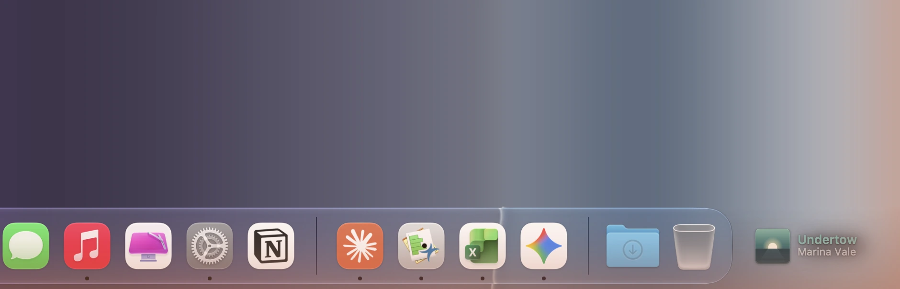

<sub>The records in these pictures are made up and their covers are drawn in code (`-NeedleDemo YES`), so no one's library is shown.</sub>

## Install

- **Download:** get `Needle-macOS-v1.0.0.zip` from [Releases](https://github.com/Yvsleyen00941/Needle/releases/latest),
  unzip it and move Needle to Applications.
- **Homebrew:** `brew install --cask Yvsleyen00941/tap/needle`

Needle needs macOS 26 or later. It isn't notarized, so macOS won't open it the first time. Go to
System Settings → Privacy & Security and click Open Anyway. For an exact fit, give Needle
Accessibility access from Settings → Placement. It uses that access only to read where the Dock is.
Without it, Needle works out where the Dock is from the Dock's own preferences.

### Build it

```sh
xcodegen generate
xcodebuild -project Needle.xcodeproj -scheme Needle -configuration Release -derivedDataPath build build
ditto build/Build/Products/Release/Needle.app /Applications/Needle.app && open /Applications/Needle.app
```

Run the tests with `xcodebuild -project Needle.xcodeproj -scheme Needle -derivedDataPath build test`.
Signing uses team `34LM5DW4G4`; if you sign with another team, use your own bundle identifier.

Needle is a menu bar app with no Dock icon. You open its menu from the menu bar mark (a record and
the arm resting on it) or by right-clicking the cover. Opening Needle again from Finder or Spotlight
brings up Settings.

## In the corner

| | |
|---|---|
| **The cover** | The album art, with a sleeve's corner radius, so it never passes for one of the Dock's apps. It has a tight contact shadow and a soft shadow in the cover's own colours. Before the art arrives, it shows a graphite tile with a note, a microphone (podcasts) or a frame (video). |
| **The title** | In the cover's most vivid colour, lightened or darkened until it reads on the wallpaper behind it (Tape colours its names after their logos the same way). Black-and-white covers get white or black text. |
| **The artist** | Below the title, quieter. When there's room, the album follows it: *Marina Vale · Low Tide*. Edition tags are dropped: "– 2011 Remaster", "(Deluxe Edition)", "[Radio Edit]", "- Single". |
| **The clock** | Tape's clock face, by the Dock. The wedge sweeps round as the track plays and is full when the next one starts. Core Animation moves it at the track's own pace, so nothing ticks while it plays. |

A new track arrives the way a new listing does in Tape's Focus. The old one drifts up out of focus
and the new one rises into it, the cover first. **A track from the same album leaves the cover where
it is**, and only the words change. A skip back rolls the other way.

| 0 ms | 280 ms | 420 ms | settled |
|---|---|---|---|
| 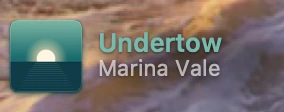 | 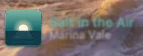 | 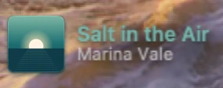 | 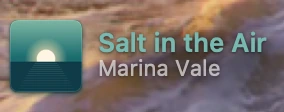 |

When the music pauses, the words and the clock fade to half strength and the cover stays as it is
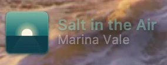. After five minutes of quiet the corner empties, and the window gets out
of the way so it doesn't catch clicks. The next track brings it back. In Settings → General you can
keep it showing or clear it sooner. A track that was paused hours ago doesn't come back at login.

### Hands on

- **Click the cover** to play or pause. A play or pause button shows on the cover under the pointer.
- **Click the title** to see the cover large, in a card of glass above the corner. The card has the
  full title and album, a line you can drag to skip through the track, previous, play and next, and
  a button to open the app that's playing.

  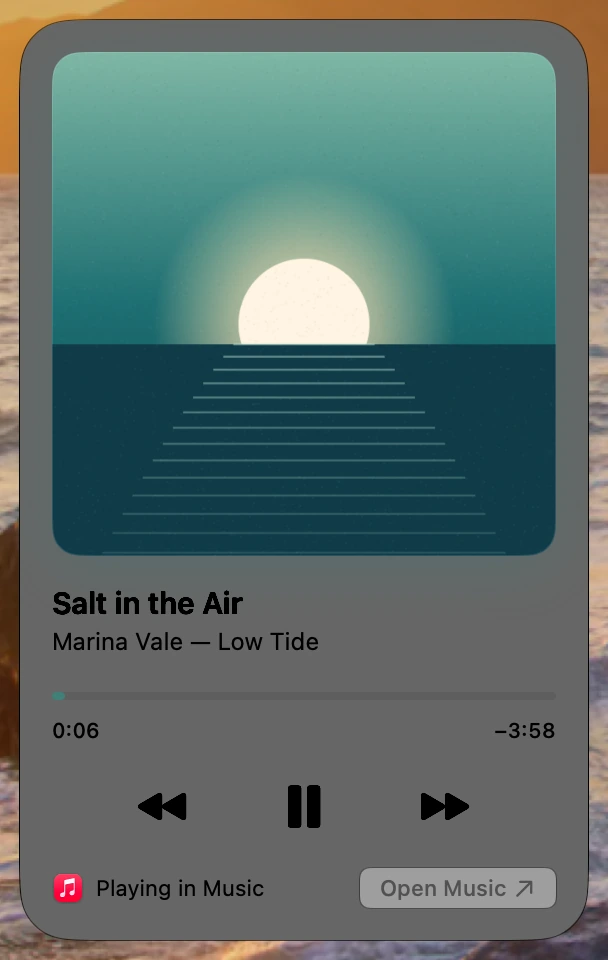
- **Swipe with two fingers or turn the wheel** over the corner to skip to the next or previous track.
  You can turn this off in Settings.
- **Right-click** for the track, play, next, previous, Show the Cover, Open Music (or Spotify, Safari…),
  Settings and Quit. The menu bar mark opens the same menu.

## Fits any Dock

The corner can be a 368-point strip on a 1080p monitor or 74 points beside a long Dock on a
laptop. Needle uses the widest layout that fits, and the cover keeps its place from one song to the
next:

| Strip | Shows |
|---|---|
| wide | cover, title in its colour over *artist · album*, and the clock  |
| on glass | the same on a pane of the Dock's glass, its corners concentric with the cover's 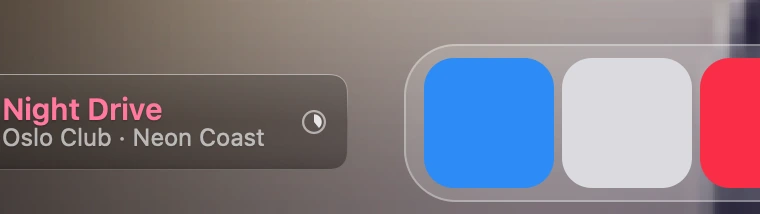 |
| about 130 pt | a smaller cover and smaller words, without the clock 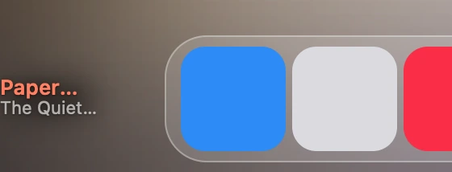 |
| about 74 pt | the cover and the clock: the corner made for an album cover 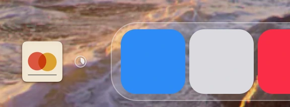 |
| narrower still | the cover alone, as large as the strip allows |

Placement is Tape's. The window sits between the screen's edge and the Dock's glass, centred on the
icons. When there's room to spare, the slide is centred in the corner. It follows the Dock as apps
open and close and as the Dock grows or shrinks, slides in and out with an auto-hiding Dock, and
redraws for each screen's scale. Text is light or dark to suit the wallpaper behind it, or you can
choose. Settings → Placement chooses the side and the distance from the Dock.

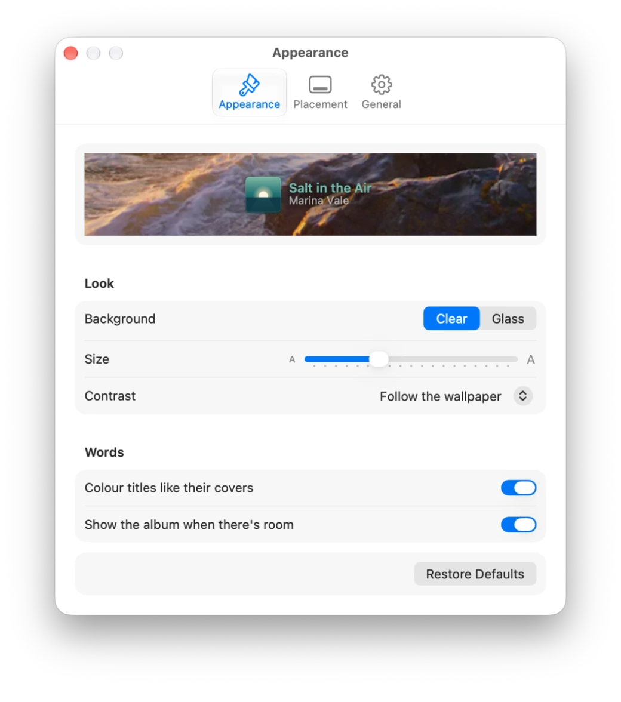

## How it reads Now Playing

Control Center gets Now Playing from a private system service, MediaRemote. Since macOS 15.4 that
service only answers Apple's own programs. Needle ships a small library, `libNeedleBridge.dylib`
([Bridge/NeedleBridge.m](Bridge/NeedleBridge.m)), and loads it into `/usr/bin/perl`, which is one of
Apple's programs. The bridge passes Needle one line of JSON each time something changes: the title,
artist, album, length, position, rate, the app that plays, and the cover (sent once per picture).
Needle sends commands back the same way: play, pause, next, previous, seek. When Needle quits, the
bridge quits with it. When the bridge stops, Needle starts it again after a short wait, and the wait
grows each time. This approach comes from
[ungive/mediaremote-adapter](https://github.com/ungive/mediaremote-adapter).

Nothing leaves your Mac. Needle makes no network requests.

## Layout

```
Bridge/NeedleBridge.m        the library that runs inside perl and talks to MediaRemote
Needle/Player/               the bridge process, the track (NowPlaying), the remote, demo records
Needle/Drawing/Slide.swift   Focus for a track: metrics, the grid for each strip, the drawing
Needle/Drawing/CoverColor    a cover's colour and tone
Needle/Corner/               the window, placement, the slide view with its motion and clock, glass
Needle/Card/                 the cover card
Needle/Dock/                 measuring the Dock (from Tape)
Needle/Settings/             Appearance, Placement, General
tools/make_icon.swift        the app icon
```

Debug and checking:

- `Needle -NeedleRender <file.png>` draws what's playing over the wallpaper. Add `-NeedleDemo YES`
  for a demo record, `-NeedleStrip 74` to simulate a narrower corner, or `-NeedleScale 1` to draw at 1×.
- `Needle -NeedleRenderSet <folder>` draws the demo records at seven strip widths, clear and on glass.
- `Needle -NeedleShots <folder> -NeedleDemo YES` (debug builds only) photographs Needle's own windows:
  the corner, a skip as it happens, paused, on glass, the card and each settings pane.
  `-NeedleShotsAlpha YES` keeps them transparent.
- `open -n -a /Applications/Needle.app --args -NeedleDockInfo <file>` writes what Needle measures of the Dock.

## Notes and limits

- MediaRemote is private. If a future macOS closes the way in through perl, Needle shows
  "Now Playing can't be read" in its menu and in Settings, rather than guessing.
- Some players never report the track's length (live radio, some web players). Those tracks have no clock.
- Like Tape, Needle reads the desktop picture to choose light or dark text. With an Aerial
  wallpaper, macOS reports the default picture rather than the moving one, so set Contrast by hand
  if the text looks wrong.

MIT licence. © 2026 Yorben Vander Sleyen.
